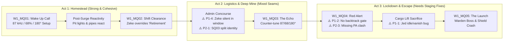

# Starborn — World 1 ("The Mines") Narrative & Dialogue Audit

> [!IMPORTANT]
> **Audit Scope & Authority:** Evaluated against live implementation assets (`app/src/main/assets/*.json`) and canonical story documentation (`docs/story/*`). No workspace files were modified.

---

## 1. Executive Assessment

World 1 of **Starborn** (*Stellarium Colony 4: "The Mines"*) has a remarkably strong narrative backbone. Unlike many indie JRPG openings that spend their first hour explaining cosmology, World 1 grounds its inciting incident in **labor, maintenance, and physical causality**. Nova does not stumble into destiny by accident; she deliberately bypasses a `61 kHz` factory safety governor on her phase-cutter ([`w1_mq01_confirm_governor`](file:///Users/jason/Developer/starbornandroid/app/src/main/assets/events.json#L981-L1012)) to chase a 12% seam loss and meet a rigged Dominion quota, triggering a breaker surge ([`scene_cutter_surge`](file:///Users/jason/Developer/starbornandroid/app/src/main/assets/cinematics.json#L715-L741)) that flags her file for "Mandatory Retirement," wakes the buried Architect Tuning Fork, and costs her surrogate father his life.

Recent narrative passes on the main-path script ([`dialogue.json`](file:///Users/jason/Developer/starbornandroid/app/src/main/assets/dialogue.json), [`rooms.json`](file:///Users/jason/Developer/starbornandroid/app/src/main/assets/rooms.json), [`tuning_puzzles.json`](file:///Users/jason/Developer/starbornandroid/app/src/main/assets/tuning_puzzles.json)) have elevated the core cast—particularly **Nova**, **Jed**, **Zeke**, **Doc**, and **Scrapper**—into sharp, economical, subtext-rich voices that exemplify the [Starborn Writer's Handbook](file:///Users/jason/Developer/starbornandroid/docs/story/Starborn_Writer_Handbook.md#L1-L265) ("blue-collar cosmic" sci-fi where warmth is expressed through action and corporate horror is expressed through bureaucracy).

However, **the seams between narrative design and room/event staging currently undermine World 1's climax and several secondary beats**. Where Act 1 (waking in the Pit, repairing the cutter with Jed, and Zeke's paperwork override at the checkpoint) feels cohesive and reactive, Act 2 suffers from spatial and state-gating contradictions during the Red Alert lockdown (`w1_mq04`), a split-identity side quest (`w1_sq03`), an unfulfilled narrative/mechanical promise in the Server Room (`w1_sq04`), a silent Zeke placement in Logistics (`admin_window`), and a few jarring tonal collisions between the oppressive company-town setting and late-game/meta Easter egg dialogue (`pit_mess`).

Fixing World 1 does **not** require rewriting its story or overhauling its prose. It requires closing a small set of high-leverage staging, continuity, and quest-cohesion gaps so the emotional payoff of Jed's sacrifice and Zeke's defection lands with the same precision as the opening act.



### Implementation Status Breakdown

| Content State | Specific World 1 Material |
| :--- | :--- |
| **Implemented & Live** | Cold open ([`intro_prologue`](file:///Users/jason/Developer/starbornandroid/app/src/main/assets/cinematics.json#L562-L674)) + fade-in ([`new_game_fade_in`](file:///Users/jason/Developer/starbornandroid/app/src/main/assets/cinematics.json#L266-L278)); 5 Main Quests (`w1_mq01`–`w1_mq05`) & 5 Side Quests (`w1_sq01`–`w1_sq05`) in [`quests.json`](file:///Users/jason/Developer/starbornandroid/app/src/main/assets/quests.json#L2-L654); 82 playable rooms in [`rooms.json`](file:///Users/jason/Developer/starbornandroid/app/src/main/assets/rooms.json#L1-L3660); 10 nodes in [`hub_nodes.json`](file:///Users/jason/Developer/starbornandroid/app/src/main/assets/hub_nodes.json#L1-L310); 2 tuning puzzles in [`tuning_puzzles.json`](file:///Users/jason/Developer/starbornandroid/app/src/main/assets/tuning_puzzles.json#L3-L82); 8 enemy types in [`enemies.json`](file:///Users/jason/Developer/starbornandroid/app/src/main/assets/enemies.json#L2-L374). |
| **Planned in Docs (`00_world_story.md`) / Altered in Live** | **`EVT_W1_00: The Volunteer`** ([`00_world_story.md`](file:///Users/jason/Developer/starbornandroid/docs/story/world_1_mining_colony/00_world_story.md#L137-L142)) not implemented in Hub 1; **Hard PONR / Lockdown Gate** ([`00_world_story.md`](file:///Users/jason/Developer/starbornandroid/docs/story/world_1_mining_colony/00_world_story.md#L511)) not enforced in room exits; **First Vale PA Interruption (`EVT_W1_02`)** ([`00_world_story.md`](file:///Users/jason/Developer/starbornandroid/docs/story/world_1_mining_colony/00_world_story.md#L235-L248)) compressed into a system popup; **Gh0st's Boot Prints** ([`00_world_story.md`](file:///Users/jason/Developer/starbornandroid/docs/story/world_1_mining_colony/00_world_story.md#L512)) absent from Sector 4 rooms; **Admin Access Passive (`w1_sq04`)** ([`00_quest_list.md`](file:///Users/jason/Developer/starbornandroid/docs/story/world_1_mining_colony/00_quest_list.md#L25)) replaced by a generic `circuit_board`. |
| **Unused / Legacy in Assets** | Legacy town/vertical-slice dialogues in [`dialogue.json`](file:///Users/jason/Developer/starbornandroid/app/src/main/assets/dialogue.json#L10-L189) and [`dialogue.json`](file:///Users/jason/Developer/starbornandroid/app/src/main/assets/dialogue.json#L367-L435) (`dlg_bran_intro`–`dlg_tallo_intro`, `ellie_*`, `kasey_*`, `maddie_*`, `jed_energy_core_turnin_*`, `ollie_intro_scene`); VFX demo cinematics/events in [`cinematics.json`](file:///Users/jason/Developer/starbornandroid/app/src/main/assets/cinematics.json#L1-L265) and [`events.json`](file:///Users/jason/Developer/starbornandroid/app/src/main/assets/events.json#L60-L401); test rooms `weather_lab` and `debug_presence_stress` in [`rooms.json`](file:///Users/jason/Developer/starbornandroid/app/src/main/assets/rooms.json#L197-L234). |
| **Not Inspected (Non-Text Runtime)** | Rendered `.webp` visual composition, real-time particle/camera rendering, and runtime audio mix in the compiled Android app. |

---

## 2. Category Scores (1–10)

| ID | Category | Score | Summary Explanation |
| :--- | :--- | :---: | :--- |
| **A** | **Dialogue Quality** | **8.5 / 10** | Main-path and side-quest conversations are crisp, natural, and subtext-driven, with almost zero "RPG lore-dump" bloat. Held back slightly by verbose Easter egg dialogue (`matriarch_pam`) and mechanical UI terms bleeding into character speech. |
| **B** | **Characterization** | **8.5 / 10** | Nova, Jed, Zeke, Doc, Scrapper, and Boggs have unmistakable, internally consistent voices. Zeke has a missing mid-act beat in `admin_window` where he falls back to a generic global bark instead of bridging his arc from clerk to lockdown hacker. |
| **C** | **Story Structure & Pacing** | **7.5 / 10** | Act 1 (`w1_mq01`–`w1_mq02`) is a masterclass in causal setup and pacing. Act 2's climax (`w1_mq04`–`w1_mq05`) loses structural tension because nothing gates backtracking to the Homestead during Red Alert, and `w1_sq03` has a split two-hub structure. |
| **D** | **Emotional Impact** | **7.5 / 10** | Zeke's horror at the "Mandatory Retirement" screen, *The Lost Shift* datapad (`w1_sq05`), and Jed's written farewell lines are genuinely moving. However, Jed's sacrifice in `launch_lift` is undercut by awkward spatial staging (standing idle alongside live enemies with a contradictory pre-fight bark, then vanishing in front of Nova). |
| **E** | **Humor & Personality** | **8.5 / 10** | Dry, fatalistic blue-collar humor lands naturally through workplace friction (`CLOSED: WITHIN QUOTA`, Hank's door philosophy, Scrapper's contraband dry wit, the Cox call-center terminal) without puncturing the stakes. |
| **F** | **Prose & Worldbuilding** | **8.5 / 10** | Environmental prose across the 82 rooms is concrete, tactile, and reactive after the cutter surge. Minor deductions for occasional POV shifts ("Nova" vs. "you" in the Echo Chamber/Mine Junction) and a handful of generic filler inspects. |
| **G** | **Narrative Continuity** | **6.5 / 10** | The core `87 kHz / 68% / 180°` causal chain is superb, but continuity breaks in several places: Orion's named portrait spoiling `"???"` in the prologue, Pam ("Gaga") talking about Nova knowing World 2/World 4 characters, Homestead NPCs acting normal during Red Alert, and `w1_sq04` dropping `"Chorus"` while failing to deliver its promised admin override. |

---

## 3. Top 10 Highest-Impact Improvements

| Rank | ID | Improvement | Priority | Effort | Expected Player Benefit |
| :---: | :---: | :--- | :---: | :---: | :--- |
| **1** | `P1-1` | **Re-stage Jed's Sacrifice in `launch_lift` (`w1_mq04`)** so Jed isn't standing idle beside live enemies with a contradictory wrench bark before the fight, and doesn't pop out of existence while Nova remains in the room. | **P1** | Medium | Protects the emotional climax of World 1 and makes Jed's death feel physical, urgent, and earned. |
| **2** | `P1-2` | **Enforce the Red Alert Lockdown Gate (`w1_mq04`–`w1_mq05`)** at `echo_heart` / `launch_access` so Nova cannot stroll back into a peaceful Homestead Mess Hall after triggering the colony alarm or watching Jed die. | **P1** | Low–Med | Preserves climax urgency and eliminates severe narrative/world-state dissonance. |
| **3** | `P1-3` | **Fix `intro_prologue` Portrait Spoiler & `new_game_fade_in` Dead Air** by removing `orion_angry.png` / `orion_worried.png` from `"speaker": "???"` steps and trimming the 8.0-second silent blank fade-in. | **P1** | Low | Preserves the 20-year mystery of the Sector 9 sleeper until World 2 and fixes a jarring 8-second stall at New Game start. |
| **4** | `P1-4` | **Add Room-Specific Dialogue for Zeke in `admin_window` (`w1_mq03`)** instead of falling back to his generic `zeke_default_talk` one-liner when Nova passes him in Customer Service. | **P1** | Low | Bridges Zeke's character arc from trembling clerk in `checkpoint_booth` to proactive comms hacker in `w1_mq04`. |
| **5** | `P2-1` | **Unify `w1_sq03` ("Heavy Lifting") Narrative & Quest Tasks** so Boggs's mandatory Security Post shield drill (`admin_security`) doesn't collide with orphaned "trapped workers behind a cargo collapse" text in `workshop_dock` and `quests.json`. | **P2** | Low–Med | Eliminates confusing ghost objectives (`rescue_trapped_workers`) on the mandatory main-path progression gate. |
| **6** | `P2-2` | **Fulfill `w1_sq04` ("Protocol Override") Narrative Promise & Remove Premature `"Chorus"` Drop** by making the recovered rebel access key pay off in security/lockdown work and replacing `"Chorus"` with colony-grounded resistance language. | **P2** | Low–Med | Rewards exploration with narrative reactivity and protects the Lore Bible's Source reveal ladder. |
| **7** | `P2-3` | **Bring the Lockdown Broadcast (`EVT_W1_02`) to Life in `w1_mq04_start_lockdown`** by replacing the dry system `show_message` after `scene_relic_sync` with the Warden's purge order + the cold PA override. | **P2** | Low | Establishes the Warden-vs.-Vale duality right as the alarm trips, rather than waiting until the final room of the world. |
| **8** | `P2-4` | **Ground Pam ("Gaga") in `pit_mess` & Resolve the "Cook Vance / Rourke" Naming Collision** so Nova doesn't act like she already knows Megan (World 2) and Cameron (World 4), and "Vance" isn't shared across three unrelated characters. | **P2** | Low | Preserves the warm personal tribute to Gaga while keeping World 1's isolated-colony premise intact. |
| **9** | `P2-6` | **Add Subtle Pre-Lockdown Foreshadowing of Zeke (`EVT_W1_00` / Bulletin Notice) and Gh0st's Boot Prints in Sector 4** via lightweight room/inspect beats in `pit_L2_corridor` and `mine_antechamber`. | **P2** | Low | Strengthens setup-and-payoff across World 1 and World 2 with zero new asset dependencies. |
| **10** | `P3-1` | **Standardize Third-Person POV ("Nova" vs. "You") & Replace Remaining Generic Inspects** across `echo_walkway`, `mine_junction`, `medbay_exhaust`, and `admin_lobby`. | **P3** | Low | Aligns all 82 World 1 rooms with the [Starborn Writer's Handbook](file:///Users/jason/Developer/starbornandroid/docs/story/Starborn_Writer_Handbook.md#L126-L157). |

---

## 4. Detailed Findings

### P1 — Foundational Narrative Problems

#### [P1-1] Climax Staging & Contradictory Dialogue in `launch_lift` Undermine Jed's Sacrifice
* **Priority:** `P1`
* **Locations & IDs:**
  * [`rooms.json` (`launch_lift`, lines 3361–3432)](file:///Users/jason/Developer/starbornandroid/app/src/main/assets/rooms.json#L3361-L3432)
  * [`dialogue.json` (`jed_w1_launch_lift_idle`, lines 351–359; `jed_w1_mq04_sacrifice_1`–`7`, lines 191–235)](file:///Users/jason/Developer/starbornandroid/app/src/main/assets/dialogue.json#L191-L235)
  * [`events.json` (`w1_mq04_lift_pressure`, `w1_mq04_gauntlet_victory`, `w1_mq04_complete`, lines 2619–2786)](file:///Users/jason/Developer/starbornandroid/app/src/main/assets/events.json#L2619-L2786)
* **Problem:**
  1. When Nova enters `launch_lift` during `w1_mq04`, `acoustic_bulwark` and `resonance_buoy` are present in the room alongside Jed (`npc_presence` requires only `ms_w1_mq03_complete`, [`rooms.json`](file:///Users/jason/Developer/starbornandroid/app/src/main/assets/rooms.json#L3421-L3431)).
  2. If the player taps Jed *before* clearing the enemies, Jed's sacrifice dialogue is gated by `stage:w1_mq04:cargo_lift_sacrifice`, so he instead delivers [`jed_w1_launch_lift_idle`](file:///Users/jason/Developer/starbornandroid/app/src/main/assets/dialogue.json#L351-L359): *"Go, Nova! I've got the manual bypass wedged with my wrench. If I step away, the lift locks down. Get to the Launch Bay!"* This creates **three simultaneous contradictions**:
     * He tells Nova to go to the Launch Bay before giving her the `ghost_signal_cell` (Chime) and while the North exit is still locked by `ms_w1_mq04_complete`.
     * He claims he has the bypass *"wedged with my wrench"*, whereas two minutes later in [`jed_w1_mq04_sacrifice_3`](file:///Users/jason/Developer/starbornandroid/app/src/main/assets/dialogue.json#L204-L210) he tells Nova *"I've tried the wrench already, Nova"* because the brake has to be held by hand.
     * Inspecting `[override panel]` ([`rooms.json`](file:///Users/jason/Developer/starbornandroid/app/src/main/assets/rooms.json#L3400-L3404)) already states *"A wrench lies bent beside the housing"* before the conversation even occurs.
  3. Immediately after [`jed_w1_mq04_sacrifice_7`](file:///Users/jason/Developer/starbornandroid/app/src/main/assets/dialogue.json#L225-L234) triggers `player_action:jed_sacrifice` (`ms_w1_mq04_complete`), Jed's `npc_presence` rule (`forbidden_milestones: ["ms_w1_mq04_complete"]`) causes Jed to **instantly vanish from the room** while Nova is still standing on the lift platform.
* **Why It Matters:** Jed's sacrifice is the emotional thesis of World 1. Having him shout a contradictory idle bark before combat and then pop out of existence while Nova is still standing in `launch_lift` flattens the tragedy into a visible scripting seam.
* **Recommendation:**
  1. Rewrite `jed_w1_launch_lift_idle` (and gate it to pre-victory `stage:w1_mq04:lockdown_escape`) so it reflects the active fight on the lift platform.
  2. Have `w1_mq04_complete` either warp Nova one room North into `launch_checkpoint` as the lift car rises and the blast doors seal behind her, or keep a post-handoff state so Jed does not vanish in front of her.
* **Illustrative Dialogue Fix (`jed_w1_launch_lift_idle`):**
  ```text
  BEFORE:
  Jed: "Go, Nova! I've got the manual bypass wedged with my wrench. If I step away, the lift locks down. Get to the Launch Bay!"

  AFTER:
  Jed: "Clear that shield unit off the platform, Nova! The brake pawl's sheared—my wrench bent trying to wedge it, so I'm holding the lever by hand!"
  ```

---

#### [P1-2] Unrestricted Backtracking to a Peaceful Homestead During Red Alert (`w1_mq04`–`w1_mq05`)
* **Priority:** `P1`
* **Locations & IDs:**
  * [`rooms.json` (`echo_heart`, `launch_access`, `pit_mess`, `checkpoint_bay`)](file:///Users/jason/Developer/starbornandroid/app/src/main/assets/rooms.json#L2889-L2962)
  * [`events.json` (`w1_mq04_emergency_route_pressure`, `w1_mq04_launch_access_pressure`, lines 2560–2617)](file:///Users/jason/Developer/starbornandroid/app/src/main/assets/events.json#L2560-L2617)
  * [`00_world_story.md` (Point of No Return, line 511)](file:///Users/jason/Developer/starbornandroid/docs/story/world_1_mining_colony/00_world_story.md#L511)
* **Problem:** Once `ms_w1_mq03_complete` fires, event narration explicitly states that containment blast doors are slamming shut behind Nova (`"Each alarm pulse closes another door behind Nova"`, `"A blast door slams behind Nova"`). Yet none of the backward room connections (`launch_lift` -> `launch_access` -> `echo_exit` -> `echo_heart` -> `echo_walkway`) or hub travel nodes are locked during `w1_mq04` or `w1_mq05`. A player who walks back to Hub 1 during Red Alert—or even *after* Jed's sacrifice—finds `pit_mess` miners casually arguing about the breaker over dinner ([`rooms.json`](file:///Users/jason/Developer/starbornandroid/app/src/main/assets/rooms.json#L48)), Guard Hank calmly checking shift badges in `checkpoint_bay` ([`dialogue.json`](file:///Users/jason/Developer/starbornandroid/app/src/main/assets/dialogue.json#L878-L887)), and Doc/Scrapper offering peacetime idle lines.
* **Why It Matters:** Allowing surface/Homestead backtracking during the lockdown creates severe narrative dissonance and contradicts the explicit text of the escape sequence.
* **Recommendation:** Lock the backward exit from `echo_heart` (south to `echo_walkway`) and/or `launch_access` (south to `echo_exit`) and disable Hub/Node fast-travel back to Homestead/Deep Mine once `ms_w1_mq03_complete` is set.
* **Illustrative Gate Copy (`locked_message`):**
  ```text
  "The containment bulkhead is sealed behind Nova. The only open route is forward through the maintenance strobes toward the Launch Bay."
  ```

---

#### [P1-3] `intro_prologue` Spoils `"???"` Identity with Orion's Named Emote Portraits & `new_game_fade_in` Stalls for 8.0 Seconds
* **Priority:** `P1`
* **Locations & IDs:**
  * [`cinematics.json` (`intro_prologue`, steps 4 & 7, lines 604–619, 647–662)](file:///Users/jason/Developer/starbornandroid/app/src/main/assets/cinematics.json#L604-L662)
  * [`cinematics.json` (`new_game_fade_in`, lines 266–278)](file:///Users/jason/Developer/starbornandroid/app/src/main/assets/cinematics.json#L266-L278)
* **Problem:**
  1. In [`intro_prologue`](file:///Users/jason/Developer/starbornandroid/app/src/main/assets/cinematics.json#L562-L674) (*"The Signal — Twenty Years Earlier"*), the prose carefully preserves the mystery of the Sector 9 operator (`"An operator locks the brass Chime into the tube"`, `"speaker": "???"`) so the player does not know who launched the Chime until discovering Orion's stasis pod in World 2 (`w2_mq03`). However, steps 4 and 7 attach `"portrait": "images/characters/emotes/orion_angry.png"` and `"images/characters/emotes/orion_worried.png"`, displaying Orion's face over the custom full-bleed cinematic plates.
  2. Immediately after `intro_prologue` finishes, [`new_game_fade_in`](file:///Users/jason/Developer/starbornandroid/app/src/main/assets/cinematics.json#L266-L278) runs a single step with `"duration": 8.0`, `"text": ""`, `"caption_style": "none"`, and no audio cue—leaving the player staring at a dark screen for 8 full seconds before gameplay begins in `pit_nova_bunk`.
* **Why It Matters:** Spoiling Orion's appearance in the prologue undercuts the World 2 stasis reveal, and an 8-second silent pause into a dark room feels like a soft-lock on first launch.
* **Recommendation:** Remove `"portrait"` from steps 4 and 7 of `intro_prologue` (letting the custom cinematic plates carry the visual while `"speaker": "???"` stays mysterious), and reduce `new_game_fade_in` duration from `8.0` to `1.5`–`2.0` seconds.

---

#### [P1-4] Zeke Has No Room-Specific Dialogue in `admin_window` ("Customer Service") Between `w1_mq02` and `w1_mq04`
* **Priority:** `P1`
* **Locations & IDs:**
  * [`rooms.json` (`admin_window`, lines 1868–1918)](file:///Users/jason/Developer/starbornandroid/app/src/main/assets/rooms.json#L1868-L1918)
  * [`dialogue.json` (`zeke_default_talk`, lines 565–573)](file:///Users/jason/Developer/starbornandroid/app/src/main/assets/dialogue.json#L565-L573)
* **Problem:** After Zeke overrides Nova's retirement flag in `checkpoint_booth` (`ms_w1_mq02_complete`), he is spawned in Hub 2's `admin_window` ("Customer Service", [`rooms.json`](file:///Users/jason/Developer/starbornandroid/app/src/main/assets/rooms.json#L1907-L1917)), directly on the mandatory path between Boggs (`admin_lobby`) and the Security Post (`admin_security`). However, every Zeke dialogue node in [`dialogue.json`](file:///Users/jason/Developer/starbornandroid/app/src/main/assets/dialogue.json#L453-L573) is gated to `room:checkpoint_booth`, `room:launch_bay`, or `room:launch_pod`. Talking to Zeke in `admin_window` only outputs his generic fallback [`zeke_default_talk`](file:///Users/jason/Developer/starbornandroid/app/src/main/assets/dialogue.json#L569-L572): *"Give me a moment. I like to know what a switch does before someone makes me press it."*
* **Why It Matters:** In `w1_mq02`, Zeke is a terrified clerk whose hands are shaking as the booth camera logs his breach. In `w1_mq04`, he is suddenly hacking colony comms, tracking blast doors, and coordinating with Jed at the cargo lift. Because his appearance in `admin_window` has no dialogue, the player misses *why* he moved into Logistics Customer Service and *how* he prepared the escape route before the alarm went off.
* **Recommendation:** Add a short 3-line exchange for Zeke in `room:admin_window` (gated to `ms_w1_mq02_complete` and `milestone_not_set:ms_w1_mq03_complete`).
* **Illustrative Dialogue Addition (`room:admin_window`):**
  ```text
  Zeke: "Don't stand too close to the glass. I told my supervisor I needed the Sector 4 maintenance maps from Customer Service to reconcile your transfer."
  Nova: "You're still at a desk? The camera in the booth already logged you."
  Zeke: "If I bolt before the shift audit runs, security flags us both immediately. Finish Boggs's errand—I'm keeping a comm line and the service lift routing open from this terminal just in case."
  ```

---

### P2 — Important Narrative Improvements

#### [P2-1] `w1_sq03` ("Heavy Lifting: Required Training") Is Split Between Two Contradictory Narratives
* **Priority:** `P2`
* **Locations & IDs:**
  * [`quests.json` (`w1_sq03`, lines 500–565)](file:///Users/jason/Developer/starbornandroid/app/src/main/assets/quests.json#L500-L565)
  * [`dialogue.json` (`bogs_w1_mq03_review_1`–`4`, `bogs_w1_sq03_intro_1`–`3`, lines 677–775)](file:///Users/jason/Developer/starbornandroid/app/src/main/assets/dialogue.json#L677-L775)
  * [`rooms.json` (`workshop_dock`, lines 902–962; `admin_security`, lines 1919–1974)](file:///Users/jason/Developer/starbornandroid/app/src/main/assets/rooms.json#L902-L962)
  * [`events.json` (`w1_sq03_start_loader`, `w1_sq03_move_cargo`, `w1_sq03_training_victory`, lines 1488–1651)](file:///Users/jason/Developer/starbornandroid/app/src/main/assets/events.json#L1488-L1651)
* **Problem:** `w1_sq03` stitches together two incompatible versions of the quest:
  1. **Hub 2 Main-Path Flow (`admin_lobby` -> `admin_security`):** Talking to Boggs in `admin_lobby` (`bogs_w1_mq03_review_1`–`4`) starts `w1_sq03`, unlocks `nova_hydraulic_kick` immediately, and skips Stage 1 (`clear_cargo_collapse`) straight to Stage 2 (`guard_break_training`). Yet Stage 2's final task in [`quests.json`](file:///Users/jason/Developer/starbornandroid/app/src/main/assets/quests.json#L543-L545) still has `"id": "rescue_trapped_workers"` (with display text `"Complete the drill"`).
  2. **Hub 1 Orphaned Dock Flow (`workshop_dock`):** In [`workshop_dock`](file:///Users/jason/Developer/starbornandroid/app/src/main/assets/rooms.json#L902-L938), the room description never mentions a cargo collapse or trapped workers (*"An automated loader sits idle on the dock floor"*). Yet interacting with `[cargo rail]` ([`rooms.json`](file:///Users/jason/Developer/starbornandroid/app/src/main/assets/rooms.json#L922-L927)) prints: *"The loader shoves the cargo along the rail, clearing enough space for the trapped workers to breathe."* Meanwhile, `bogs_w1_sq03_intro_1`–`3` (*"Cargo collapse on the dock... There are workers behind that pile"*) is gated to `room:admin_lobby` after `w1_sq03` is already at Stage 2.
* **Why It Matters:** Every player must complete `w1_sq03` to unlock the Deep Elevator. Seeing references to trapped workers on an empty dock—or having Boggs hand out `nova_hydraulic_kick` in an office lobby without Nova touching the loader—weakens both the mechanical tutorial and the story beat.
* **Recommendation:** Either (A) frame `w1_sq03` cleanly around Boggs's Hub 2 Security Post shield drill and turn `workshop_dock`'s loader into a pure salvage/practice rig (removing the phantom "trapped workers" message), or (B) depict the pinned crew in `workshop_dock` so Nova earns `nova_hydraulic_kick` by freeing them in Hub 1 before certifying on the shield trainer in `admin_security`.

---

#### [P2-2] `w1_sq04` ("Protocol Override") Breaks Its Narrative & Mechanical Promise and Drops `"Chorus"` Prematurely
* **Priority:** `P2`
* **Locations & IDs:**
  * [`quests.json` (`w1_sq04`, lines 567–610)](file:///Users/jason/Developer/starbornandroid/app/src/main/assets/quests.json#L567-L610)
  * [`cinematics.json` (`scene_sq04_hack`, lines 523–539)](file:///Users/jason/Developer/starbornandroid/app/src/main/assets/cinematics.json#L523-L539)
  * [`events.json` (`w1_sq04_compile_spoof`, lines 15628–15685)](file:///Users/jason/Developer/starbornandroid/app/src/main/assets/events.json#L15628-L15685)
* **Problem:**
  1. [`quests.json`](file:///Users/jason/Developer/starbornandroid/app/src/main/assets/quests.json#L570) promises: *"Find the old rebel terminal, restore its protocol spoof, and leave with admin access that can shave time off future security work."* Completing the puzzle in [`w1_sq04_compile_spoof`](file:///Users/jason/Developer/starbornandroid/app/src/main/assets/events.json#L15628-L15685) only awards a generic `circuit_board` x1 and sets `ms_w1_sq04_completed`, which is never referenced again.
  2. [`scene_sq04_hack`](file:///Users/jason/Developer/starbornandroid/app/src/main/assets/cinematics.json#L531-L536) flashes: *"Fragments of suppressed logs flash past: failed strikes, sealed shafts, and a single word repeated in the margin: 'Chorus.'"* Per the [Lore Bible](file:///Users/jason/Developer/starbornandroid/docs/story/Lore_Bible.md#L21-L55), the Chorus is Aethel/Source terminology introduced in World 2+, not colony labor-rebel terminology.
* **Why It Matters:** `w1_sq04` is Hub 2's signature investigation puzzle. Ending it with a 10-credit crafting part and an unacknowledged World 2 lore word leaves its best hook (`"IF YOU ARE READING THIS, WE FAILED. THE SPOOF STILL WORKS"`) without a payoff.
* **Recommendation:** Replace `"Chorus"` in `scene_sq04_hack` with colony-grounded rebel stakes, and have `ms_w1_sq04_completed` trigger a reactive payoff during `w1_mq04`/`w1_mq05` (e.g., Zeke using Nova's recovered rebel spoof to bypass a lockdown interlock or pre-calibrate one parameter of `w1_chime_spoof`, plus awarding a unique mod/passive).
* **Illustrative Cinematic Line Fix (`scene_sq04_hack`, step 2):**
  ```text
  BEFORE:
  "Fragments of suppressed logs flash past: failed strikes, sealed shafts, and a single word repeated in the margin: 'Chorus.'"

  AFTER:
  "Fragments of suppressed logs flash past: failed strikes, sealed shafts, and a list of 'retired' badge numbers whose spoofed credentials still hold the maintenance bus open."
  ```

---

#### [P2-3] The Lockdown Broadcast (`EVT_W1_02`) Is Reduced to a System Toast Instead of the Warden / PA Clash
* **Priority:** `P2`
* **Locations & IDs:**
  * [`events.json` (`w1_mq04_start_lockdown`, lines 2481–2527)](file:///Users/jason/Developer/starbornandroid/app/src/main/assets/events.json#L2481-L2527)
  * [`00_world_story.md` (`EVT_W1_02: The Lockdown`, lines 235–248)](file:///Users/jason/Developer/starbornandroid/docs/story/world_1_mining_colony/00_world_story.md#L235-L248)
* **Problem:** When `scene_relic_sync` finishes in `echo_heart`, `w1_mq04` starts with a single system `show_message` ([`events.json`](file:///Users/jason/Developer/starbornandroid/app/src/main/assets/events.json#L2523-L2525)): *"WARNING: unregistered resonance event detected. Asset 942-D reclassified from labor to containment threat. Sector lockdown active."* In [`00_world_story.md`](file:///Users/jason/Developer/starbornandroid/docs/story/world_1_mining_colony/00_world_story.md#L235-L248), this beat was designed to introduce **both** the Iron Warden (ordering a Sector 4 purge) and Vale's cold PA relay voice overriding him (*"Correction, Warden. Cruelty is inefficient. Simply recycle the asset"*). Currently, the player does not hear either voice until the very end of `w1_mq05` in `launch_bay`.
* **Why It Matters:** Staging the Warden/PA clash when the lockdown begins turns `w1_mq04` into an active pursuit by two distinct antagonists and makes the second PA interruption in `launch_bay` (`warden_w1_mq05_intro_2`) pay off as a pattern.
* **Recommendation:** Replace or follow the `w1_mq04_start_lockdown` toast with a 2-step PA broadcast exchange between the Warden and the PA Relay.

---

#### [P2-4] Pam ("Gaga") in `pit_mess` Breaks World 1 Continuity, Plus the "Cook Vance / Rourke" Naming Collision
* **Priority:** `P2`
* **Locations & IDs:**
  * [`dialogue.json` (`pam_greeting`–`pam_bye`, lines 2932–2983; `cook_vance_talk`, lines 1856–1864)](file:///Users/jason/Developer/starbornandroid/app/src/main/assets/dialogue.json#L2932-L2983)
  * [`rooms.json` (`pit_mess`, lines 38–98; `pit_kitchen`, lines 100–135)](file:///Users/jason/Developer/starbornandroid/app/src/main/assets/rooms.json#L38-L135)
  * [`npcs.json` (`cook_vance`, `matriarch_pam`, lines 379–396)](file:///Users/jason/Developer/starbornandroid/app/src/main/assets/npcs.json#L379-L396)
* **Problem:**
  1. In [`pam_family_reply`](file:///Users/jason/Developer/starbornandroid/app/src/main/assets/dialogue.json#L2965-L2973), Nova asks *"You must be proud of Megan and Cameron"* and Pam replies that Megan is *"running clinical science on the coast"* (World 2 Sector 9) and Cameron is *"working sixty hours a week on the high-pressure pipes"* (World 4 Foundry). In World 1, Nova has spent her life in an underground mining colony, has never seen the coast or the Foundry, and has not met Megan or Cameron yet. Pam's lines also run up to 62 words with multiple exclamation marks (exceeding the [Writer's Handbook](file:///Users/jason/Developer/starbornandroid/docs/story/Starborn_Writer_Handbook.md#L58-L95) 35-word / 2-sentence / no-exclamation-inflation rules).
  2. In `pit_kitchen`, the NPC is named `"Cook Vance"` in [`npcs.json`](file:///Users/jason/Developer/starbornandroid/app/src/main/assets/npcs.json#L380) and [`rooms.json`](file:///Users/jason/Developer/starbornandroid/app/src/main/assets/rooms.json#L120), but his dialogue speaker name is `"Rourke"` ([`dialogue.json`](file:///Users/jason/Developer/starbornandroid/app/src/main/assets/dialogue.json#L1859))—while `"Vance"` is already **Nova Vance**'s surname and **Director Vance**'s surname in World 3.
* **Why It Matters:** Players in `pit_kitchen` will think "Cook Vance" is related to Nova Vance, and having Nova already know about the coast and the Foundry in `pit_mess` undercuts the isolation of the Pit.
* **Recommendation:**
  1. Change `"Cook Vance"` to `"Cook Rourke"` in `npcs.json:380` and `rooms.json:120`.
  2. Frame Megan and Cameron in Gaga's dialogue as **transferred off-sector**, so Gaga is telling Nova about them for the first time (setting up a warm recognition beat when the player meets Megan in World 2 and Cameron in World 4).
* **Illustrative Dialogue Fix (`pam_ask_family` -> `pam_family_reply`):**
  ```text
  Nova: "Your kids still transferred off-sector?"
  Gaga: "Transferred and thriving. Megan's running clinical science out on the coast—sharpest mind you'll ever meet, even if she forgets to drink water."
  Gaga: "And Cameron's pulling sixty-hour weeks on the high-pressure pipes, tough as iron. If you ever get out from under this rock, tell them Gaga said to eat."
  ```

---

#### [P2-5] Redundant Post-Cinematic & Post-Action Messages Repeat Immediate Dialogue
* **Priority:** `P2`
* **Locations & IDs:**
  * [`events.json` (`w1_mq01_cryo_inductor_repaired`, lines 935–943; `w1_sq04_compile_spoof`, lines 15678–15681)](file:///Users/jason/Developer/starbornandroid/app/src/main/assets/events.json#L935-L943)
  * [`dialogue.json` (`jed_w1_mq01_after_tinker_1`, lines 298–301)](file:///Users/jason/Developer/starbornandroid/app/src/main/assets/dialogue.json#L298-L301)
  * [`cinematics.json` (`scene_sq04_hack`, line 535)](file:///Users/jason/Developer/starbornandroid/app/src/main/assets/cinematics.json#L535)
* **Problem:**
  * [`w1_mq01_cryo_inductor_repaired`](file:///Users/jason/Developer/starbornandroid/app/src/main/assets/events.json#L936-L943) pops up a `narrate` box (*"Cold loop: 68%. Before the live test, ground the Flux Liner and confirm the governor bypass."*) and immediately auto-starts `jed_w1_mq01_after_tinker_1`, where Jed says the exact same sentence.
  * [`scene_sq04_hack`](file:///Users/jason/Developer/starbornandroid/app/src/main/assets/cinematics.json#L535) ends with *"The terminal writes its recovered key to the cracked circuit board in the isolated socket, then wipes the screen clean"*, and [`w1_sq04_compile_spoof`](file:///Users/jason/Developer/starbornandroid/app/src/main/assets/events.json#L15678-L15681) immediately shows a popup saying *"The access key copies to the cracked circuit board, then erases itself from the terminal."*
* **Why It Matters:** Double-reporting the same action back-to-back slows pacing and makes system narration feel redundant with character dialogue.
* **Recommendation:** Remove the duplicate `narrate` / `show_message` actions where a character dialogue or cinematic step already delivers the exact same information.

---

#### [P2-6] Missing Early Foreshadowing Beats (`EVT_W1_00` Zeke Trace & Gh0st's Sector 4 Boot Prints)
* **Priority:** `P2` *(Optional / High-Value Polish from `00_world_story.md`)*
* **Locations & IDs:**
  * [`00_world_story.md` (`EVT_W1_00`, lines 137–142; `Gh0st's Boot Prints`, lines 369–371, 512)](file:///Users/jason/Developer/starbornandroid/docs/story/world_1_mining_colony/00_world_story.md#L369-L371)
  * [`rooms.json` (`pit_L2_corridor`, lines 235–294; `mine_antechamber`, lines 2831–2888)](file:///Users/jason/Developer/starbornandroid/app/src/main/assets/rooms.json#L2831-L2888)
* **Problem:** Zeke has no presence or mention in Hub 1 before `checkpoint_booth`, and Gh0st's Sector 4 boot prints (marked "Included" in `00_world_story.md:512`) are absent from all `mine_*` / `echo_*` rooms.
* **Why It Matters:** A single trace of Zeke in Hub 1 and a single `[boot prints]` inspect in `mine_antechamber` connect World 1's exploration directly to `w1_mq02` and World 2 (`w2_mq04`).
* **Recommendation *(Optional Suggestion)*:** Add Zeke's clerk signoff to the `[notice]` in `pit_L2_corridor` and add an inspectable `[boot prints]` trigger in `mine_antechamber`:
  ```text
  "A single track of narrow, evenly spaced boot prints crosses the stone dust toward the chamber wall and stops. Too light for miner treads, too clean for Dominion riot gear."
  ```

---

#### [P2-7] Mechanical System Terms Bleeding Directly Into Character Speech
* **Priority:** `P2`
* **Locations & IDs:**
  * [`dialogue.json` (`jed_w1_mq01_intro_4`, line 264; `bogs_w1_mq03_review_4`, line 699; `bogs_w1_sq03_turnin_2`, line 774)](file:///Users/jason/Developer/starbornandroid/app/src/main/assets/dialogue.json#L696-L775)
* **Problem:** Lines like Jed's *"Open the Field Kit from the top bar"* and Boggs's *"You're cleared for Guard Break"* put UI/system terminology directly into character mouths.
* **Why It Matters:** Preserving in-world industrial phrasing in dialogue while letting quest objectives and tutorials name the UI mechanics keeps character voices grounded.
* **Recommendation:**
  ```text
  BEFORE (bogs_w1_sq03_turnin_2):
  Foreman Boggs: "Good. You know how to crack a riot shield without burning a clip. You're cleared for Guard Break."

  AFTER:
  Foreman Boggs: "Good. You know how to crack a riot shield without emptying a cell into the plating. That's your heavy-gear signoff."
  ```

---

### P3 — Prose and Dialogue Polish

#### [P3-1] Second-Person ("You") vs. Third-Person ("Nova") POV Drift in Echo Chamber & Deep Mine
* **Priority:** `P3`
* **Locations & IDs:**
  * [`rooms.json` (`echo_walkway`, lines 2963–3002)](file:///Users/jason/Developer/starbornandroid/app/src/main/assets/rooms.json#L2963-L3002)
  * [`events.json` (`w1_cart_track_reset`, `w1_cart_release`, `w1_cart_brake_unread`, lines 15404–15599)](file:///Users/jason/Developer/starbornandroid/app/src/main/assets/events.json#L15404-L15599)
* **Problem:** World 1 uses close third-person (`"Nova"`) across nearly all rooms, but [`echo_walkway`](file:///Users/jason/Developer/starbornandroid/app/src/main/assets/rooms.json#L2968-L3000) shifts to second-person (*"yet you feel no fear of falling"*, *"your footsteps"*, *"your head ache"*), and the `mine_junction` ore-cart events mix `"You release the wheel brake"` with `"Nova holds the brake"`.
* **Recommendation:** Standardize `echo_walkway` and `w1_cart_*` to third-person `"Nova"` and physical sensation:
  ```text
  BEFORE (echo_walkway):
  "A bridge of seamless dark material spans a bottomless chasm. There are no handrails, yet you feel no fear of falling."

  AFTER:
  "A bridge of seamless dark alloy spans the chasm without handrails or bolts. Even with the drop open on both sides, Nova's boots find steady purchase on the warm stone."
  ```

---

#### [P3-2] Remaining Generic / Cliché Environmental Inspects in Optional Rooms
* **Priority:** `P3`
* **Locations & IDs:**
  * [`rooms.json` (`medbay_exhaust` -> `[vent pipe]`, line 1277; `trade_back`, lines 1426–1435; `admin_lobby`, line 1791)](file:///Users/jason/Developer/starbornandroid/app/src/main/assets/rooms.json#L1274-L1278)
* **Problem:** Inspecting `[vent pipe]` in `medbay_exhaust` prints *"The scale of the mining operation is breathtaking... and terrifying"*—an abstract cliché with ellipsis inflation that violates the [Writer's Handbook](file:///Users/jason/Developer/starbornandroid/docs/story/Starborn_Writer_Handbook.md#L16-L35). `admin_lobby` also lacks a post-certification description variant after Boggs clears Nova.
* **Recommendation:** Replace `medbay_exhaust`'s `[vent pipe]` text with concrete sensory detail:
  ```text
  BEFORE:
  "The scale of the mining operation is breathtaking... and terrifying."

  AFTER:
  "Warm chemical exhaust rises from five stacked mining levels below, carrying coal dust and the thrum of deep-bore drills."
  ```

---

#### [P3-3] Legacy Vertical-Slice Dialogues and Demo Rooms Clutter World 1 Asset Ranges
* **Priority:** `P3`
* **Locations & IDs:**
  * [`dialogue.json` (lines 10–189, 367–435)](file:///Users/jason/Developer/starbornandroid/app/src/main/assets/dialogue.json#L10-L189)
  * [`rooms.json` (`weather_lab`, `debug_presence_stress`, lines 197–234, 3607–3660)](file:///Users/jason/Developer/starbornandroid/app/src/main/assets/rooms.json#L197-L234)
* **Problem:** Roughly 250 lines at the start of `dialogue.json` belong to cut vertical-slice NPCs (`Bran`, `Iva`, `Juno`, `Leto`, `Pasha`, `Rana`, `Sedge`, `Sera`, `Sima`, `Tallo`, `Ellie`, `Kasey`, `Maddie`, `jed_energy_core_turnin_*`).
* **Recommendation:** Archive unused vertical-slice entries out of live `dialogue.json` during the polish phase to prevent trigger collisions.

---

## 5. Narrative Strengths Worth Preserving

1. **The Causal Spine (`87 kHz / 68% / 180°`) Connecting Gameplay, Character Flaw, and Climax:**
   * **References:** [`w1_mq01_cryo_inductor_repaired`](file:///Users/jason/Developer/starbornandroid/app/src/main/assets/events.json#L881-L944), [`w1_mq01_patch_flux_liner`](file:///Users/jason/Developer/starbornandroid/app/src/main/assets/events.json#L947-L979), [`w1_mq01_confirm_governor`](file:///Users/jason/Developer/starbornandroid/app/src/main/assets/events.json#L981-L1012), [`w1_echo_counter_tune`](file:///Users/jason/Developer/starbornandroid/app/src/main/assets/tuning_puzzles.json#L3-L43), [`scene_relic_sync`](file:///Users/jason/Developer/starbornandroid/app/src/main/assets/cinematics.json#L742-L779).
   * **Why It Works:** The player physically repairs the Cryo-Inductor (`68%`), clamps the Flux Liner ground strip (`180°`), and confirms the bypassed cutter sweep (`87 kHz`). In `echo_heart`, the tuning puzzle uses those exact three numbers from Nova's workshop receipt, and Jed's ground strip literally saves Nova's life when the circuit discharges.
2. **Opening Economy & Post-Surge Environmental Reactivity:**
   * **References:** [`pit_nova_bunk`](file:///Users/jason/Developer/starbornandroid/app/src/main/assets/rooms.json#L316-L426), [`pit_L1_landing`](file:///Users/jason/Developer/starbornandroid/app/src/main/assets/rooms.json#L9-L16), [`pit_mess`](file:///Users/jason/Developer/starbornandroid/app/src/main/assets/rooms.json#L43-L50), [`pit_shaft`](file:///Users/jason/Developer/starbornandroid/app/src/main/assets/rooms.json#L162-L169).
   * **Why It Works:** `CLOSED: WITHIN QUOTA` over a sparking bunk door panel establishes Dominion's neglect in four words, and the post-surge `description_variants` across the Pit make the colony visibly react to Nova's mistake.
3. **The "Paperwork Murder" Scene (`w1_mq02`):**
   * **References:** [`zeke_w1_mq02_override_1`–`7`](file:///Users/jason/Developer/starbornandroid/app/src/main/assets/dialogue.json#L468-L553), [`scene_zeke_override`](file:///Users/jason/Developer/starbornandroid/app/src/main/assets/cinematics.json#L486-L521).
   * **Why It Works:** Turning form-filling (`"Grid Instability — Substation 4B"`) into a life-or-death choice grounds the banality of Dominion evil and gives Zeke an unforgettable introduction (*"Help me choose the field. My hands aren't being useful"*).
4. **The "Names vs. Numbers" Motif Across Side Quests (`w1_sq01`, `w1_sq02`, `w1_sq05`):**
   * **References:** [`scrapper_w1_sq01_turnin_1`–`3`](file:///Users/jason/Developer/starbornandroid/app/src/main/assets/dialogue.json#L596-L614), [`doc_w1_sq02_intro_3`](file:///Users/jason/Developer/starbornandroid/app/src/main/assets/dialogue.json#L636-L640), [`scene_sq05_datapad`](file:///Users/jason/Developer/starbornandroid/app/src/main/assets/cinematics.json#L541-L560).
   * **Why It Works:** Scrapper (*"Names? Keep those. I don't trade in them"*), Doc (*"They returned it with the box for 'acceptable losses' checked. I have names in those beds"*), and the Lost Shift datapad (*"She puts the datapad away instead of leaving it with the empty helmets"*) reinforce the central theme without preaching.
5. **Tactical & Atmospheric Item/Enemy Copy:**
   * **References:** [`enemies.json`](file:///Users/jason/Developer/starbornandroid/app/src/main/assets/enemies.json#L3-L374), [`items.json`](file:///Users/jason/Developer/starbornandroid/app/src/main/assets/items.json#L827-L1819).
   * **Why It Works:** Enemy and snack descriptions (`dominion_dampener`, `resonance_buoy`, `starbar_crunch`, `mineral_trail_mix`) fuse mechanical telegraphing with blue-collar gallows humor.

---

## 6. Character Voice Assessment

| Character | Voice Rating | Established Voice & Key Strengths | Watchouts / Fixes Needed |
| :--- | :---: | :--- | :--- |
| **Nova Vance** | **9.0 / 10** | Clipped, practical, defensive, observant. Measures the world in torque, quota percentages, and exits (*"Ticket says you fixed it yesterday"*, *"You're holding a whole corridor with a badge and a bad posture"*). | Trim omniscient politeness in `pam_ask_family` (`dialogue.json:2943`). |
| **Jed** | **9.0 / 10** *(Prose)*<br>**6.5 / 10** *(Staging)* | Gruff, unhurried, tactile. Expresses love through maintenance, rations, and restraint (*"I can mend the cutter, Nova. You make the other job harder"*). | Fix `launch_lift` pre-fight idle bark and post-dialogue vanish (`P1-1`). |
| **Zeke** | **8.5 / 10** | Anxious procedural precision that cracks into rapid, breathless conscience under pressure (*"Help me choose the field. My hands aren't being useful"*). | Add room-specific dialogue in `admin_window` (`P1-4`) to bridge `w1_mq02` -> `w1_mq04`. |
| **Foreman Boggs** | **8.5 / 10** | Exhausted middle-management gravel caught between Dominion quotas and reckless miners (*"Then we both have a problem we can't file away"*). | Unify `w1_sq03` dialogue (`P2-1`) and replace *"cleared for Guard Break"* tooltip phrasing (`P2-7`). |
| **The Iron Warden & PA Relay (Vale)** | **8.0 / 10** | Effective contrast between the Warden's blunt military-police bark and the PA Relay's surgical corporate calm (*"Correction, Warden. Do not damage the resonant hardware"*). | Restore the first Warden/PA clash at the start of `w1_mq04` (`P2-3`). |
| **Doc, Scrapper & Guard Hank** | **9.0 / 10** | Instant, memorable characterization in under 8 lines each (*"Reader says red, door stays shut. Reader says green, I stop caring where you go"*). | Preserve as-is; model future world side-quest NPCs on this economy. |
| **Orion & Gh0st (W1 Setup)** | **8.0 / 10** | Orion's cold-open urgency is crisp; Gh0st is held offscreen as an unseen tracker. | Remove Orion's named portrait from `"???"` in `intro_prologue` (`P1-3`); add Gh0st's `[boot prints]` in Sector 4 (`P2-6`). |

---

## 7. Recommendations for Future Worlds (Worlds 3–6)

### Principles to Carry Forward into Worlds 3–6
1. **Physical Causality Over "Relic Magic":** Every Echo Relic puzzle (`The Lens`, `The Anvil`, `The Anchor`, `The Key`) should draw its tuning parameters from concrete engineering, architectural, or heist actions the crew performed earlier in that world—just as `87 kHz / 68% / 180°` comes directly from Nova's workshop cutter repair.
2. **Institutional Evil Expressed Through Everyday Systems:** Keep showing Dominion's villainy through how each tier measures and discards human beings (Lower/Upper Spire credit & transit strata in World 3, Foundry heat-loss quotas in World 4, Orbital Ring executive optimization in World 5) before the boss ever draws a weapon.
3. **Affection Expressed Through Action, Craft, and Restraint:** Preserve the rule that party members show care through their trade—Zeke spoofing clearances, Orion stabilizing coolant/pressure loops, Gh0st pausing a trigger or covering a blind spot—rather than sentimental speeches.
4. **Environmental Reactivity + Climax Backtrack Gates:** Every world should feature at least one mid-world state shift that updates hub descriptions/barks, and every climax escape must hard-gate backward travel so urgency never collides with peacetime hub NPCs.
5. **Anchor Personal Easter Eggs Inside the Local Horizon:** Frame personal tributes as physical salvage or off-sector rumors appropriate to what the crew knows at that point in the campaign.

### World 1-Specific Choices NOT to Duplicate Mechanically
1. **Do Not Repeat the "Accidental Fugitive / Collapsing Home Hub" Arc:** World 1 is about losing the only home Nova has ever known through a shortcut gone wrong. In Worlds 3–5, the crew of the *Astra* arrives with deliberate agency (heisting the Lens, sabotaging the Foundry core, infiltrating the Ring). Let Nova shift from *reactive survivor* to *deliberate instigator*.
2. **Do Not Keep Zeke in "Panicked Clerk" Mode Past World 2:** By World 3 (The Spire—his old corporate habitat), Zeke's voice should evolve from trembling complicity into weaponized institutional fluency, actively conning and dismantling Dominion procedure.
3. **Do Not Confine Later Worlds to Subterranean Rust-and-Grime:** Preserve the crew's blue-collar perspective, but let it clash against vastly different visual and social palettes (neon cyberpunk stratification in World 3, industrial crucible scale in World 4, sterile executive luxury in World 5).
