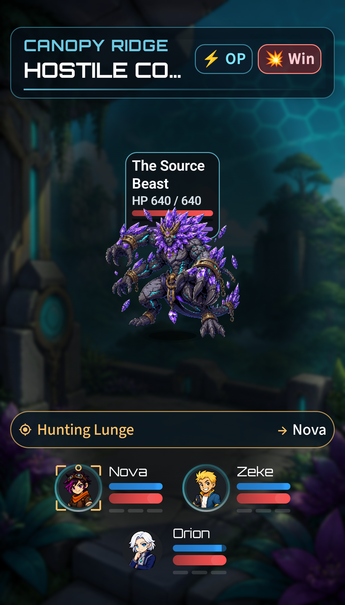

# Stable combat targeting cues — November 13, 2026

Replaced the expanding top warning card after the focused Worlds 1–2 playtest. The old card was measured as part of the combat column: adding it reduced the enemy viewport's height, which could move and shrink the formation.

## Result

- Android warnings occupy the existing 56dp combat-message area between enemies and crew. Desktop uses its existing 24dp separator. Both areas retain their dimensions regardless of warning/phase/resource state.
- A compact amber cue uses the actual skill name and a distinct target label, e.g. **Hunting Lunge → Nova**. Frenzy retains the sequence number. The full source, original preparation wording and target list remain available to accessibility services.
- A static amber corner marker surrounds each living threatened portrait until the preparation resolves, is cancelled or the battle ends. It does not resize the portrait or add flashing animation.
- Two simultaneous Android warnings fit as two slim rows; desktop compact cues share the existing row. Additional groups can scroll horizontally. Existing direct enemy targeting stays available, and tapping a cue focuses its source.
- Phase/resource information is a compact secondary label in the message area. Ordinary impact feedback still uses that area when no preparation is active. Desktop no longer duplicates authored warning prose beneath the enemy.

No enemy size presets, sprite files, combat stats, turn timing, damage, rewards or save contents changed. The combat controller gained only a read-only skill-name lookup for presentation.

## Verification

**16 focused tests passed:** six combat runtime regressions, six desktop presentation/flow/formation tests and four Android instrumentation tests.

The Android test uses an actual Beast preparation, then freezes the isolated test battle and changes only preparation/phase presentation state. It asserts identical enemy viewport, Beast card and crew bounds across warning, cleared-warning and phase-label states at 100% and 130% font scale. It also checks that the correct portrait marker appears and clears. The two-warning case checks that both remain visible in the fixed message space. Existing five-target readability and distinct target dispatch still pass.

Desktop tests exercise portrait and wide formations with warning, cleared-warning and phase-label states, compare the sprite/crew bounds exactly, verify portrait markers and cue source selection, and retain the normal combat-flow and formation checks. Combat regressions include the previously verified earned Warden/Beast strategies and prototype reward/control contracts; this presentation change does not retune those encounters.

Evidence: [logs, geometry, results and phone preview](evidence/combat_target_cues_2026-11-13/).

Only the isolated laboratory emulator's `.playtest` package was updated for verification. The Pixel and regular campaign installation were not changed during this UI pass. No version increment, commit or push was performed.
